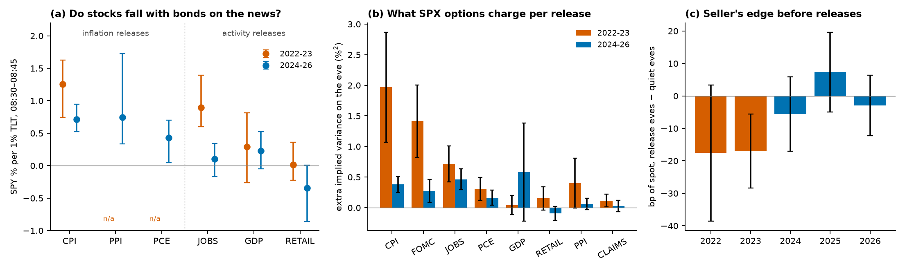

# Which options respond to which macro news, and do they charge the right amount?

Erdős Institute, Introduction to Quantitative Methods in Finance, Fall 2026.

US macro data (CPI, the jobs report, PCE, GDP and others) comes out at 08:30 ET on dates known in advance. Options expiring the next day have to price that risk the evening before. This project measures, for about 450 release mornings from May 2022 to October 2026:

1. **How stocks respond to the news**, and how that depends on what the news does to interest rates.
2. **What options charge for each release**, across release types, maturities and underlyings.
3. **Whether the charge was right**, using a delta-hedged straddle built from the Black–Scholes model and delta-hedging strategy.
4. **An outside check for CPI**: Kalshi prediction-market contracts give the distribution of the CPI print the evening before, which splits the option price into "how big is the news" and "how much do stocks care".



## Questions and answers

| # | Question | Answer |
|---|---|---|
| 1 | When macro news moves bonds, do stocks move with them? | In 2022–23, yes for every major release: SPY moved 0.86% per 1% move in TLT [0.53, 1.14]. In 2024–26 it is 0.35 [0.17, 0.52]. The drop is significant (difference 0.52 [0.15, 0.85]) and happened between 2022 and 2023. |
| 2 | Does it depend on the kind of news? | Yes, since 2024. Inflation releases (CPI, PPI, PCE): 0.66. Activity releases (jobs, GDP, retail sales): 0.05. Difference [0.36, 0.89]. On jobs mornings the link fell from 0.89 to 0.10. |
| 3 | Which releases do SPX options treat as events? | Four: CPI, FOMC, jobs and PCE carry a significant premium in one-day implied variance. GDP, retail sales, PPI and jobless claims carry none. |
| 4 | How did the pricing change? | The CPI premium fell from 1.97 %² to 0.38 %², FOMC from 1.41 to 0.27, jobs from 0.71 to 0.46. CPI went from nearly three times the jobs report to level with it. |
| 5 | Did options charge the right amount? | Not in 2022–23: a hedged seller of one-day straddles earned 17 bp less on release eves than on quiet eves (t −3.1), because realized variance was 95% of implied on release days against 77% on quiet days. In 2024–26 the gap is gone (−0.6 bp, t −0.2). |
| 6 | Is there an ordinary-day premium to selling one-day options? | Not at traded prices. Priced at VIX1D the seller appears to earn 8 to 14 bp a day, but VIX1D is about 6% above at-the-money implied volatility. With traded SPY, QQQ and IWM option prices the seller earns 2 to 4 bp, not distinguishable from zero and before bid-ask costs. |
| 7 | Do different underlyings price the news differently? | Yes. Relative to its own quiet-day variance, IWM (small caps) prices CPI, jobs and FOMC about twice as heavily as SPY; QQQ is similar to SPY. IWM sellers earned more before inflation releases (+12 bp over quiet eves, t 1.8), which is suggestive only. |
| 8 | CPI, with Kalshi: did options price the stock sensitivity correctly? | Yes in 2022–23 (implied sensitivity 9.3 %/pp against a realized 9.8). In 2024–26 the realized sensitivity fell to 3.8 and option prices are consistent with it; an apparent 2 to 3× overpricing did not survive a time-varying estimate or a placebo test. A Kalshi-based trading rule has no value (−4.5 bp per release against +3.1 for always selling). |

**In one paragraph.** In 2022 all macro news was interest-rate news: whatever the release, stocks fell when bonds fell. Since 2023 that holds only for inflation releases, at about half strength; activity news moves bonds without moving stocks. Option prices followed: the CPI premium fell fivefold, the jobs premium by a third. During the 2022–23 regime one-day options undercharged for release days relative to quiet days, and by 2024 that gap had closed. There is no tradeable edge in the 2024–26 data.

## Data

| Source | Series | Use |
|---|---|---|
| FRED release calendar | Exact dates of CPI, Employment Situation, PPI, retail sales, GDP, PCE, jobless claims | Labelling release mornings; FOMC dates are hard-coded |
| Alpaca Market Data | 1-minute bars for SPY, TLT, IEF, QQQ, IWM (SIP, pre-market included), 2022-05 to 2026-10 | Window returns, hedging, realized variance |
| Alpaca option bars | SPY, QQQ, IWM options expiring the next session, from 2024-02 | Traded straddle prices |
| Cboe | VIX1D, VIX9D, VIX daily history | Implied variance by maturity |
| Kalshi API | KXCPICORE, KXCPI contract ladders | Distribution of the CPI print on the eve |
| FRED / ALFRED | First-release CPI index levels | Unrounded CPI print |

Mornings are labelled by their highest-ranked event in the order CPI, jobs, FOMC, PCE, GDP, retail sales, PPI, claims. Quiet days have none of these: 235 in 2022–23 and 426 in 2024–26.

## Methods

**Stock response to rate news (γ).** In the 15 minutes after 08:30, r is the SPY return and b the TLT return. Release mornings contain the same background shocks as quiet mornings plus the news, so (Rigobon and Sack, 2004)

γ = [Cov_release(r, b) − Cov_quiet(r, b)] / [Var_release(b) − Var_quiet(b)]

is the SPY move per 1% TLT move caused by the news. It needs no measure of the surprise. Intervals are percentile bootstraps; estimates are withheld when bonds move less than 1.5 times their quiet-morning variance.

**What options charge.** One-day implied variance is V = VIX1D²/252 (%²). The event premium is V on the eve minus the median V over quiet eves within ±5 sessions. From February 2024 the same is computed from traded at-the-money straddles on SPY, QQQ and IWM.

**Whether the charge was right.** On every eve, sell a one-day at-the-money straddle, hold the Black–Scholes delta in the underlying through the overnight gap, rebalance at the open (and every 5 or 30 minutes as robustness), and settle at the close. The profit is approximately Σ ½ΓS²(σ²_implied − σ²_realized)Δt, so it is positive when options overcharged. Pricing and delta functions are the course's (`course_bs.py`, Lectures 6 to 8). Release eves are compared with quiet eves of the same period.

**The Kalshi decomposition for CPI.** Kalshi's "CPI above k" contracts give the survival function of the print, hence its mean and standard deviation σ_K. With surprise s = actual − Kalshi mean and r = βs + ε, options should charge about β²σ_K² for the surprise. β is estimated by regression and, time-varying, by a Kalman filter on a random-walk β_t.

## Validation

- **Hedging engine on simulated GBM.** Mean P&L equals BS(V_implied) − BS(V_true) within Monte Carlo error at 1, 13, 78 and 390 rebalances a day (−17.0 bp against −16.9 when realized variance is 1.5× implied).
- **Pre-release placebo for γ.** In 08:05–08:20, before the data, bond variance on release mornings is close to or below the quiet-morning level for every release type except PCE, where one day (24 Feb 2023) dominates.
- **Two identifications of the same number.** For CPI, γ instrumented with the Kalshi surprise is 1.47 → 0.75; the Kalshi-free estimate is 1.25 → 0.71.
- **Windows.** 08:35 and 09:00 give the same γ pattern as 08:45.
- **Traded prices against VIX1D.** Replacing VIX1D by traded option prices removed an apparent ordinary-day premium (question 6).
- **Kalman filter injection–recovery.** On simulated panels matched to the CPI data the filter's 95% bands cover 92%; power to detect options assuming three times the true sensitivity is about 30%.
- **Placebo for the Kalshi decomposition.** Moving each CPI release to non-event days 3 to 10 sessions away gives an implied sensitivity near zero in 2022–23 and about 3 from noise alone in 2024–26.
- **Surprise definition.** Using the unrounded CPI print, or adding the headline surprise to core, changes R² by 0.04 or less.

## Results that did not survive testing

Four results looked real at some point in the project and were withdrawn after a check.

| Apparent result | What removed it |
|---|---|
| SPX options overprice the stock sensitivity to CPI by a factor of 2 to 3 in 2024–26. | Letting the sensitivity drift over time (Kalman filter) leaves an excess of −0.02 %² (t −0.3). On placebo days the same estimator gives an implied sensitivity of about 3 from noise alone. |
| The stock reaction to CPI surprises disappeared after 2023. | It was measured on overnight returns, where unrelated noise hides it (t −1.0). In the 15 minutes after the release it is −3.8 %/pp (t −3.4). |
| Selling one-day options earns a steady premium of 6 to 14 bp a day. | The trade was priced at VIX1D, which is about 6% above traded at-the-money volatility. At traded prices the premium is 2 to 4 bp and not significant. |
| Sellers of IWM options earn 58 bp before Fed meetings (t 3.6). | A dividend filter had dropped 9 of the 21 meetings. With all 21 the figure is 35 bp (t 1.2). |

## Main results

### Stock move per 1% bond move on release mornings (08:30–08:45, 95% bootstrap intervals)

| Release | 2022–23 | 2024–26 |
|---|---|---|
| CPI | 1.25 [0.75, 1.62] | 0.71 [0.53, 0.95] |
| PPI | not identified | 0.74 [0.34, 1.73] |
| PCE | not identified | 0.43 [0.05, 0.70] |
| Jobs | 0.89 [0.60, 1.39] | 0.10 [−0.17, 0.34] |
| GDP | 0.29 [−0.26, 0.81] | 0.23 [−0.05, 0.52] |
| Retail sales | 0.01 [−0.23, 0.36] | −0.35 [−0.86, 0.01] |
| All except claims | 0.86 [0.53, 1.14] | 0.35 [0.17, 0.52] |

By year, all except claims: 1.16, 0.43, 0.37, 0.35, 0.27 (2022 to 2026).

### Event premium in one-day SPX implied variance (%², t in brackets)

| Release | 2022–23 | 2024–26 |
|---|---|---|
| CPI | 1.97 (4.3) | 0.38 (5.6) |
| FOMC | 1.41 (4.7) | 0.27 (2.8) |
| Jobs | 0.71 (4.8) | 0.46 (5.3) |
| PCE | 0.31 (3.2) | 0.16 (2.6) |
| GDP | 0.04 (0.5) | 0.58 (1.4) |
| Retail sales | 0.15 (1.6) | −0.10 (−1.7) |
| PPI | 0.40 (1.9) | 0.06 (1.3) |
| Claims | 0.12 (2.2) | 0.03 (0.6) |

Along the curve: when CPI passed in 2022–23, 1-day, 9-day and 30-day options lost 1.5, 2.4 and 2.7 %² of total implied variance relative to quiet days; in 2024–26, 0.24, 0.79 and 1.05.

### Hedged short straddle, release eves minus quiet eves (bp of spot)

| Sample | Release eves | Quiet eves | Difference |
|---|---|---|---|
| SPY at VIX1D, 2022–23 | −3.2 (n 174) | +14.1 (n 235) | −17.3 (t −3.1) |
| SPY at VIX1D, 2024–26 | +7.3 (n 278) | +7.8 (n 426) | −0.6 (t −0.2) |
| SPY, traded prices, 2024–26 | +4.2 (n 264) | +3.3 (n 401) | +0.9 (t 0.3) |
| QQQ, traded prices, 2024–26 | +4.0 (n 264) | +1.6 (n 409) | +2.4 (t 0.5) |
| IWM, traded prices, 2024–26 | +11.0 (n 253) | +4.1 (n 402) | +6.9 (t 1.3) |

### Event premium by underlying, traded prices from February 2024 (%²; share of the ETF's quiet-day variance in brackets)

| Release | SPY | QQQ | IWM |
|---|---|---|---|
| CPI | 0.44 (0.66) | 0.67 (0.49) | 1.87 (1.32) |
| Jobs | 0.52 (0.78) | 0.84 (0.62) | 1.59 (1.12) |
| FOMC | 0.39 (0.58) | 0.70 (0.51) | 1.68 (1.18) |
| PCE | 0.14 (0.21) | 0.46 (0.34) | 0.42 (0.30) |

### CPI with Kalshi (52 core-CPI releases)

| | 2022–23 (n = 18) | 2024–26 (n = 34) |
|---|---|---|
| SPY % per pp of surprise, 08:30–08:45 | −9.2 (t −4.6, R² 0.68) | −3.8 (t −3.4, R² 0.37) |
| TLT % per pp of surprise | −6.3 (t −5.8) | −5.1 (t −4.2) |
| Sensitivity implied by options and Kalshi | 9.3 [6.9, 11.6] | 5.6 [3.7, 7.0] |
| Kalman excess event variance (%²) | +0.34 (t 0.4) | −0.02 (t −0.3) |

Kalshi's mean is unbiased; its distribution is about 1.25 times too wide, and that is robust to stricter quote filters.

## Limitations

- **Four and a half years, one regime change.** The 2022–23 results rest on 174 release days, and VIX1D is backfilled by Cboe before 24 April 2023. The underpricing of release days also holds in the live part of 2023 (−13.5 bp, t −2.3).
- **VIX1D is not a tradeable price.** It overstates at-the-money volatility by about 6%. All VIX1D-based P&L is reported as a difference between release and quiet eves, which removes a common bias but not one that differs by day type. Traded prices exist only from February 2024.
- **Trades, not quotes.** Traded-price premiums are last trades in the final 15 minutes; bid-ask costs are not included, so no result here is a net trading profit.
- **Many cells.** Release type × regime × underlying gives dozens of estimates. The headline claims are the pooled ones; single cells such as IWM before inflation releases are leads.
- **One excluded week.** 3 to 11 April 2025 (tariff announcement and pause) is excluded from the options tables. It was chosen after seeing its effect, which is to move the 2024–26 CPI premium from 0.38 to 0.14; `event_options.py --all` keeps it.
- **Kalshi panel.** Two CPI dates inferred from Kalshi (2025-10-15, 2025-11-13) were scheduled dates during the 2025 government shutdown with no release. Dropping them changes the 2024–26 sensitivity from −3.83 to −3.92. Kalshi's payroll market starts in late 2024, so the decomposition is CPI only.
- **Close-to-close realized variance by release type is too noisy to test cell by cell;** the hedged straddle is the test of pricing.

## Reproducing

```bash
pip install -r requirements.txt
cd scripts
export APCA_API_KEY_ID=... APCA_API_SECRET_KEY=...    # free Alpaca account
export FRED_API_KEY=...                               # free FRED key
for s in SPY TLT IEF QQQ IWM; do python alpaca_bars.py --sym $s; done
python fred_calendar.py
python macro_news.py                    # gamma by release and year
python straddle.py --validate           # GBM check of the hedging engine
for s in SPY QQQ IWM; do python straddle_real.py --sym $s; done
python event_options.py                 # priced / realized / earned grid
python summary_figure.py
# CPI chapter with Kalshi
python go_nogo.py --snapshot eve; python go_nogo.py --snapshot pre
python event_variance.py; python decomposition.py
python narrow_window.py; python rates_channel.py
python ss_injection.py 100 0.64; python ss_fit.py --ret win45
python straddle.py; python straddle.py --every 5
python fred_unrounded.py; python surprise_upgrade.py
python placebo.py; python spread_filter.py
```

API responses are cached under `data/cache_*`; derived tables are in `data/` and figures in `figures/`.

`notebooks/results.ipynb` walks through every result from the saved tables and runs without API keys. `reports/executive_summary.md` is the two-page summary.

| Script | Purpose |
|---|---|
| `alpaca_bars.py`, `fred_calendar.py` | Minute bars; exact release dates |
| `macro_news.py` | Stock move per unit of bond move by release type and year |
| `course_bs.py`, `straddle.py`, `straddle_real.py` | Course Black–Scholes functions; hedged straddle at VIX1D and at traded prices |
| `event_options.py`, `summary_figure.py` | The release × option grid; headline figure |
| `go_nogo.py`, `event_variance.py`, `decomposition.py` | Kalshi CPI distribution, event variance, decomposition |
| `narrow_window.py`, `rates_channel.py` | 08:30 window returns; bond and stock reaction to the Kalshi surprise |
| `ss_model.py`, `ss_injection.py`, `ss_fit.py` | Kalman filter for a time-varying sensitivity, with injection–recovery |
| `fred_unrounded.py`, `surprise_upgrade.py`, `placebo.py`, `spread_filter.py` | Robustness of the CPI chapter |

## References

- Rigobon, R. and Sack, B. (2004). The impact of monetary policy on asset prices. *Journal of Monetary Economics* 51(8).
- Bakshi, G. and Kapadia, N. (2003). Delta-hedged gains and the negative market volatility risk premium. *Review of Financial Studies* 16(2).
- Knox, B., Londono, J. M., Samadi, M. and Vissing-Jorgensen, A. (2025). Equity premium events. Working paper, Federal Reserve Board. (Closest related work to the Kalshi chapter.)
- Cboe. VIX1D methodology.
